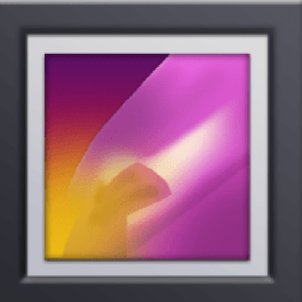

# 🗂️⚡🖼️ FastGallery

A fork of [Fossify Gallery](https://github.com/FossifyOrg/Gallery) tuned for very large libraries (built on a Pixel 8 Pro with ~68,000 photos and videos across ~250 folders).



Latest release: [v18](https://github.com/firestarter1996/FastGallery/releases/latest), `FastGallery-1.13.1-fast18.apk` (10-24-2026).

## What is different

| Problem in stock Fossify Gallery | FastGallery v22 |
|---|---|
| Every launch and every folder open re walked the folder on disk (17k files in Camera, 20k in Screenshots) before showing anything current | A per folder signature (directory mtime + cached row count + scan options) lets unchanged folders load straight from the app's own database. The album list, the album screen and the file pickers share that cache. Pull to refresh still forces a full rescan. |
| Thumbnail disk cache capped at 250 MB in `cache/`, so a big library re decoded full photos on every scroll, and Android emptied the cache under storage pressure | Thumbnail cache raised to 4 GB and moved to `no_backup/`. A nightly job (on by default, from midnight while charging) renders every visible album's thumbnails into it. |
| Rows for unchanged folders were rewritten to the database on every launch | Skipped when a folder was served from the cache |
| The album grid only appeared after a database query plus a MediaStore wide `.nomedia` scan (~0.9 s, 3.5 s+ with a cold page cache), and its covers faded in afterwards | The last album grid and its first screen of covers are saved to small files and drawn in the very first frame; the normal load refreshes them right after. The tile fade in animation is gone. |
| Album covers were read from the thumbnail cache one at a time (Glide's single disk cache thread) | 4 disk cache readers, and Glide is initialised off the main thread |
| Android 12+ showed a launch splash before the albums, also when another app opened a photo or a picker | No splash: the albums (or the photo) are the first thing drawn after the tap |
| An album showed its thumbnails only after its folder listing | Each album's first screen is saved and drawn right after its first frame; photos added since the last visit come from MediaStore before the folder listing finishes |
| Hidden `.trashed-*` rows and folders whose rows were missing made Camera/Screenshots miss the scan cache on every launch, so a new photo's cover showed up only after a 16-25 s full rescan | Stale rows are purged by path, missing rows are stored, and a changed folder is rescanned incrementally (only new/removed names) |
| Every rescan first loaded 50k row date maps from MediaStore (~6 s) and walked all of MediaStore for new folders (~7 s) | Date maps are built only if a folder really needs a full walk; new folder discovery is skipped when MediaStore's generation is unchanged |
| Rows added from MediaStore change notifications were dated with the current time until the next full scan; with a scan cache that date would stick, so old photos another app touched (for example Google Photos restoring them from its trash) sorted above today's photos | Rows always carry their real dates (MediaStore, then the `PXL_` file name time, never the scan time). A repair pass fixes wrong dates already saved, at a full load and right after an in place update. |
| Those same notification rows also let hidden folders (dot folders, `.nomedia` folders, excluded folders) into the database | Hidden folders never enter the database, and rows already saved for them are removed. No file on the phone is touched. |
| A photo started decoding only after the viewer was laid out, and it opened and closed with the system animation | The decode starts at the grid tap, the cached grid thumbnail is shown until the sharp image is ready, and the viewer opens and closes without the system animation (the swipe down gesture keeps its slide) |
| A video showed a black or stretched first frame | The tapped thumbnail stays on screen until the first video frame, at the right size |
| A playing video stopped when the screen turned off or the app went to the background | It keeps playing with audio, with a media notification, headset buttons and audio focus. Setting "Keep playing videos with the screen off", on by default. |
| Double tap seek used upstream's 1/7 edge zones | Double tap the left or right third to jump 10 s back or forward; more taps within 750 ms stack (20 s, 30 s). A small dark pill with three chevrons shows the total in the tapped half. Setting "Double tap to seek", on by default; off brings back the old edge behaviour. |
| Seeking in a playing video with the seek bar or a swipe could leave it paused | A playing video keeps playing after the seek and a paused one stays paused, in both video screens |
| The viewer started a full frame decode for five videos at once, so the one you opened showed up last | The open video decodes first and its neighbours wait their turn (uncached 4K clip on a Pixel 6 Pro: 758 ms before, 440 to 491 ms now) |
| Opening an album draws every tile black for a frame, then redraws them all; a fast fling or a fast scroller drag shows rows of black tiles | On the folder tap the album's first screen of thumbnails is fetched while the album screen starts, so its first frame already has them (0 black frames in 3 recorded opens, 1 to 2 before), and a scroll preloader fetches the rows ahead of a scroll: frames with black tiles during a hard fast scroll went from about 210 of 290 to about 37, black area from 37% to about 2% of the grid, with album open time (57 ms), scroll frame times and memory unchanged on a Pixel 6 Pro |
| Camera, search and settings sit in the top bar and the menu | A floating bottom bar with Camera, Gallery, Search and Settings, drawn with plain views. It shows icons only by default (the pill shrinks to the four icons and stays centered) and the labels come back with one switch in Settings, "Bottom bar: icons only": the first thumbnail lands at 159 ms with the bar and 156 ms without on a Pixel 6 Pro, inside the run to run spread. The bar stays on screen when an album opens too (Settings, "Keep navigation bar shown in albums", on by default; off hides it inside albums as before), and the album still opens in 55 ms against 57 ms without it |

Videos open in the app's own player unless you pick another one; upstream switched to the system player after the first run.

### Measured: stock Fossify Gallery against FastGallery v18 (Pixel 6 Pro, 7,463 photos and videos, cold start, median of 9 runs in ms, 10-25-2026)

Stock is the official Fossify Gallery 1.13.1 release APK, the upstream version FastGallery is built on. FastGallery is the v18 release APK. Each was a fresh install with the same permissions, finished its first full scan, and was compiled with the speed profile before timing.

| | Fossify Gallery 1.13.1 | FastGallery v18 |
|---|---|---|
| First frame after the tap | 64 (splash logo) | 205 (album grid with its covers) |
| Album grid and covers fully drawn and still | 557 | 239 |
| Same two after dropping the page cache | 68 (splash logo) / 856 | 274 / 302 |
| Android launch time (`am start -W` TotalTime) | 164 (first frame of an empty album list) | 167 (album grid drawn, `reportFullyDrawn`) |
| Same after dropping the page cache | 228 | 219 |

Stock shows its splash logo, then an empty album list, then the album names, and then fades the covers in. FastGallery draws the album grid with its covers in its first frame.

The screen times come from a screen recording of each launch (`scripts/perf/launch_frames_record.py` and `launch_frames_analyze.py`, counted from Android's launch start); the launch times come from `scripts/perf/measure_startup.py`. Creating `files/perf_legacy` in the app's data dir switches the optimisations off for A/B runs, and the flag files `files/perf_viewer_anim` and `files/perf_viewer_close_anim` bring the photo viewer's open and close animations back. The full measurement history is in [FastGallery.md](FastGallery.md).

Apart from the changes above and their settings, everything (features, settings, package name `org.fossify.gallery`) is stock, so it drops in over the original with your settings, pinned folders and favorites intact. Because it is signed with its own key you must uninstall the F-Droid/Obtainium build first (back up its data if you want to keep it, see below), and updates then come from this repo's Releases (Obtainium: add `https://github.com/firestarter1996/FastGallery`).

## Install keeping your data (root)

```
am force-stop org.fossify.gallery
tar -C /data/data -cf /data/local/tmp/gallery-data.tar --exclude=org.fossify.gallery/cache org.fossify.gallery
pm uninstall org.fossify.gallery
pm install -g -r FastGallery-*.apk
appops set org.fossify.gallery MANAGE_EXTERNAL_STORAGE allow
am force-stop org.fossify.gallery
U=$(stat -c %u /data/data/org.fossify.gallery)
rm -rf /data/data/org.fossify.gallery/{shared_prefs,databases,files,no_backup}
tar -C /data/data -xf /data/local/tmp/gallery-data.tar
chown -R $U:$U /data/data/org.fossify.gallery
restorecon -RF /data/data/org.fossify.gallery
```

## Building

Standard Fossify Gradle project (`./gradlew assembleFossRelease`). Signing reads `keystore.properties` or the `SIGNING_*` environment variables; the release workflow signs with the FastGallery key from repository secrets and publishes each build as a GitHub Release.

## Support

FastGallery is free with no ads. If it helps you, you can support it on GitHub Sponsors (https://github.com/sponsors/firestarter1996) or Ko-fi (https://ko-fi.com/firestarter1996). Thank you!

## License

GPL-3.0, same as upstream. Not affiliated with Fossify.

## Star History

[](https://star-history.com/#firestarter1996/FastGallery&Date)
